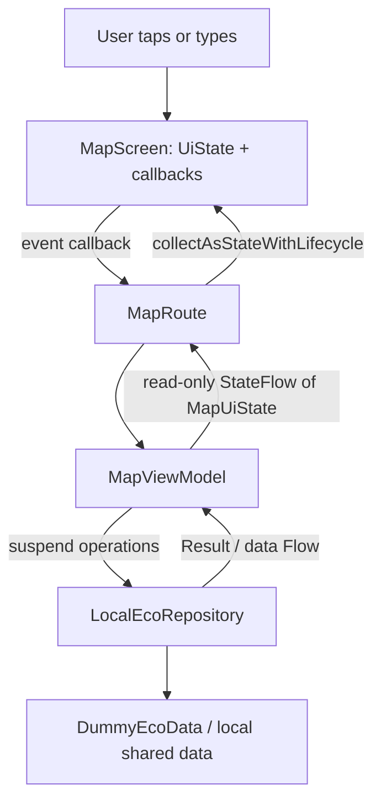

# EcoDala — Android Development (SIS3 → SIS4)

EcoDala is an Android application encouraging recycling through EcoPoints, challenges, achievements, a virtual tree and a demonstration leaderboard. The SIS4 version uses Kotlin, Jetpack Compose and **MVVM with StateFlow**, with a local data repository instead of a production backend.

> **Scope:** This is a university learning/demo application. Recycling locations and leaderboard entries are demo data, not verified public facilities or real multi-user rankings. Authentication and remote sync are not production services.

## Current application

The current `com.ecodala` implementation has navigation to Home, recycling Map/List, recycling point Details, Waste Submission, Virtual Tree, Challenges, Leaderboard, Achievements, Profile, Recycling History, Settings and Support, plus the splash flow. The application also includes local demo account/profile capabilities and Light/Dark themes.

Main features:
- Browse demo recycling points on the map or as a list, search by name/address/waste type, filter by category and mark favourites.
- Open recycling point details by `pointId`.
- Record waste submissions and calculate EcoPoints using a shared local repository.
- View current user's EcoPoints, history, challenges, achievements and virtual tree progress.
- Explore the demonstration Leaderboard, including an entry based on the current user's local points.
- Change appearance and use existing localization resources.

**Technology:** Kotlin, Jetpack Compose, Material 3, Navigation Compose, lifecycle-aware StateFlow collection, Coroutines, SavedStateHandle, local demo repository/storage and OSMDroid for the map. See Gradle files for exact dependency versions.

## SIS3 — UI and design archive

The following three-screen description and screenshots document the **earlier SIS3 submission**. They are retained for design history; the current SIS4 app contains additional screens and a different package architecture.

### 1. Home Screen

The Home Screen provides an overview of the user's environmental progress.

It displays:

- Current EcoPoints
- User level
- Global ranking
- Virtual tree progress
- Quick actions
- Recent achievements
- Bottom navigation

<table>
<tr>
<th align="center">Light Mode</th>
<th align="center">Dark Mode</th>
</tr>
<tr>
<td align="center">

</td>
<td align="center">

</td>
</tr>
</table>

---

### 2. Leaderboard Screen

The Leaderboard Screen displays users ranked by their EcoPoints.

The screen uses a `LazyColumn` and contains 10 users.

Each leaderboard item displays:

- Rank
- User name
- Faculty
- EcoPoints

<table>
<tr>
<th align="center">Light Mode</th>
<th align="center">Dark Mode</th>
</tr>
<tr>
<td align="center">

</td>
<td align="center">

</td>
</tr>
</table>

---

### 3. Recycling Point Detail Screen

The Recycling Point Detail Screen provides detailed information about a recycling center.

It includes:

- Recycling center image
- Address
- Phone number
- Opening hours
- Accepted waste types
- Sustainability information
- Route action
- Call action
- Share action
- Favorite toggle

<table>
<tr>
<th align="center">Light Mode</th>
<th align="center">Dark Mode</th>
</tr>
<tr>
<td align="center">

</td>
<td align="center">

</td>
</tr>
</table>

## Design: From Sketch to Application

The initial UI sketches were created before implementing the final application.

The sketches are stored in the `/design` directory.

The final implementation keeps the main structure of the original sketches while refining spacing, colors, icons, typography, component layouts, and Light/Dark theme support.

### Home Screen

#### Initial Sketch

<p align="center">

</p>

#### Final Application

The final Home Screen implements the main structure of the original dashboard sketch with EcoPoints, virtual tree progress, quick actions, recent achievements, and bottom navigation.

<p align="center">

</p>

### Leaderboard Screen

#### Initial Sketch

<p align="center">

</p>

#### Final Application

The final Leaderboard Screen transforms the list concept from the original sketch into a data-driven `LazyColumn` containing 10 users with their rank, faculty, and EcoPoints.

<p align="center">

</p>

### Recycling Point Detail Screen

#### Initial Sketch

<p align="center">

</p>

#### Final Application

The final Recycling Point Detail Screen keeps the main information hierarchy of the original detail sketch and adds accepted waste types, sustainability information, route, call, share, and favorite actions.

<p align="center">

</p>

## SIS4 — Current architecture

The app's current Kotlin package is `com.ecodala` (not the old `kz.ecodala`). Important current files are:

```text
app/src/main/java/com/ecodala/
├── MainActivity.kt
├── core/
│   ├── data/
│   │   ├── dummy/DummyEcoData.kt
│   │   ├── local/EcoLocalCache.kt
│   │   └── repository/LocalEcoRepository.kt
│   ├── navigation/EcoDalaNavGraph.kt
│   ├── domain/model/
│   └── domain/usecase/
├── feature/
│   ├── map/presentation/
│   │   ├── MapViewModel.kt
│   │   ├── MapScreen.kt
│   │   └── RecyclingPointDetailsViewModel.kt
│   ├── home/presentation/
│   ├── submit/presentation/
│   ├── leaderboard/presentation/
│   ├── tree/presentation/
│   ├── challenges/presentation/
│   ├── achievements/presentation/
│   └── profile/presentation/
```

The main SIS4 example is the recycling Map/List feature. The app has more ViewModels, but this feature provides one clear path through all the graded MVVM layers.

### Architecture diagram



- **View:** `MapScreen` draws UI from `MapUiState` and calls the supplied event lambdas. It does not directly fetch the recycling point list.
- **Route:** `MapRoute` creates/gets `MapViewModel`, uses `collectAsStateWithLifecycle()` and passes state/callbacks into the screen. It also handles navigation/Android intent integration.
- **ViewModel:** `MapViewModel` owns screen-level state, processes search, category changes, favourites, loading, retries and a demo error toggle.
- **Repository:** `LocalEcoRepository` owns demo recycling data and shared user data; `recyclingPoints()` uses `delay(loadingDelayMillis)` and can return `Result.failure` to simulate a loading error.

The current architecture, UiState fields, events and click trace are documented in [design/SIS4_MVVM_Architecture.md](design/SIS4_MVVM_Architecture.md), using the actual `com.ecodala` names. This document describes the current implementation; it does not establish that a plan was committed before coding.

### UiState, StateFlow and events

`MapUiState` is an immutable Kotlin data class with `val` properties, including `searchQuery`, `selectedWasteType`, `allPoints`, `favouriteIds`, `selectedPoint`, `isLoading`, `errorMessage`, `demoErrorEnabled` and `showList`. Its derived `filteredPoints` property applies search/category predicates without putting the filtering inside `MapScreen`.

`MapViewModel` keeps `private val _uiState = MutableStateFlow(...)` and exposes `val uiState: StateFlow<MapUiState> = _uiState.asStateFlow()`. Handlers update the state using `update { it.copy(...) }`.

Examples of user events handled in the ViewModel:

| UI event | MapViewModel method | Effect |
|---|---|---|
| Search field changes | `onSearchQueryChange(value)` | Updates query and visible results |
| Waste category selected | `onCategorySelected(type)` | Updates category filter |
| Favourite clicked | `onFavouriteClick(id)` | Calls repository to toggle favourite |
| Retry pressed | `onRetry()` | Triggers fresh load |
| Demo error toggled | `onDemoErrorClick()` / `onDemoErrorDisabled()` | Shows or clears simulated repository failure |
| Map/List toggled | `onListModeChange()` | Switches list/map presentation |

### Four required UI states

| State | Current behavior | Preview in `MapScreen.kt` |
|---|---|---|
| Loading | Progress indicator while repository waits | `MapLoadingPreview` |
| Content | Map or list of matching recycling points | `MapContentPreview` |
| Empty | Friendly empty result when no point matches | `MapEmptyPreview` |
| Error | Error message and Retry; optional demo-error switch-off | `MapErrorPreview` |

There is also `MapDarkPreview`. These previews use direct fake `MapUiState` values instead of fetching from a live ViewModel. **Their rendering inside Android Studio still needs to be visually verified on the developer's machine.**

### Trace one click: favourite recycling point

1. The user taps the favourite icon on a recycling point card in `MapScreen`.
2. The UI calls its `onFavouriteClick(point.id)` lambda, supplied by `MapRoute` as `viewModel::onFavouriteClick`.
3. `MapViewModel.onFavouriteClick(id)` launches a coroutine and calls `LocalEcoRepository.setFavourite(id)`.
4. The repository updates its local `favouriteIds` set and emits a new shared data value.
5. `MapViewModel` collects `repository.data` and copies updated `favouriteIds` into `MapUiState`.
6. `MapRoute` collects `uiState` via `collectAsStateWithLifecycle()` and sends it to `MapScreen`.
7. Compose recomposes the favourite control using `point.id in uiState.favouriteIds`.

This is **unidirectional data flow**: events move up from the screen, and fresh state moves down from the ViewModel.

### Detail-screen navigation and SavedStateHandle

`EcoDalaNavGraph.kt` navigates to recycling details using the selected point's ID. `RecyclingPointDetailsViewModel` retrieves `pointId` from `SavedStateHandle`, then loads that item through `LocalEcoRepository.recyclingPoint(pointId)`. This is also a candidate for SIS4 bonus credit (subject to the instructor's evaluation).

### Actual Rotation Test — Pixel 7, API 35

The application was tested on a Pixel 7 emulator running Android 15 (API 35).

**Activity lifecycle logs captured during rotation:**
```text
15:19:21.179 MainActivity.onPause instance=136985291
15:19:21.198 MainActivity.onStop instance=136985291
15:19:21.269 MainActivity.onDestroy instance=136985291 changingConfigurations=true
15:19:21.318 MainActivity.onCreate instance=117308936 restored=true
15:19:21.370 MainActivity.onStart instance=117308936
15:19:21.372 MainActivity.onResume instance=117308936
```

**ViewModel Logcat observation:**
```text
15:21:37.030 SIS4.MapViewModel init instance=169087100
```

After additional device rotations, no new `init` or `onCleared` messages appeared for MapViewModel in the observed Logcat output.

**Explanation:**

When the device rotates, Android destroys and recreates MainActivity to apply the new screen configuration. The logs confirm that the Activity instance changes, while the existing MapViewModel remains available through its retained ViewModelStoreOwner. Because the search query, selected filter, and favourite state are managed through the ViewModel's StateFlow, they remain unchanged after rotation. This demonstrates how MVVM separates UI state from the Activity lifecycle.

## Build and run

1. Open the project root `EcoDala---SIS` in Android Studio.
2. Allow Gradle Sync to finish, and confirm the Android SDK is configured.
3. Select the `app` configuration and run it on an emulator/device.
4. For build and unit tests, use the Gradle wrapper:

```powershell
.\gradlew.bat :app:assembleDebug
.\gradlew.bat :app:testDebugUnitTest
```

**Verified on 2026-10-19:** `:app:assembleDebug :app:testDebugUnitTest` completed with `BUILD SUCCESSFUL`: 17 tests, 0 failures, 0 errors. APK: `app/build/outputs/apk/debug/app-debug.apk`. Test report: `app/build/reports/tests/testDebugUnitTest/index.html`. No device was connected during the automated build check. The subsequent manual rotation test on Pixel 7 (API 35) is documented above; Preview rendering still requires verification. See [SIS4_PREPARATION.md](SIS4_PREPARATION.md) for the device checklist and defense preparation.

## SIS4 requirements and remaining verification

| SIS4 area | Implementation / evidence | Remaining action |
|---|---|---|
| A: Architecture plan | `design/SIS4_MVVM_Architecture.md` | Current names checked; early-plan chronology remains unverified |
| B1: Repository | `LocalEcoRepository.kt`, delay and simulated error | Demonstrate error/retry |
| B2: ViewModel & StateFlow | `MapViewModel.kt`, immutable `MapUiState`, multiple events | Manual rotation test completed on Pixel 7 (API 35), as documented above |
| B3: Stateless UI | `MapRoute` / `MapScreen`, lifecycle-aware collection, 4 previews | Verify previews render |
| B4: Lifecycle proof | `MainActivity.kt`, `MapViewModel.kt` logs | Activity and ViewModel observations included above |
| C: README, AI usage, Git | This README and `AI_USAGE.md` | Current AI log updated; confirm personal example and Git history |

## AI usage and development history

See [AI_USAGE.md](AI_USAGE.md) for AI assistance, current SIS4 class names and verification limits. The author still needs to confirm a personal, authentic example of AI putting logic in the wrong layer. See [SIS4_PREPARATION.md](SIS4_PREPARATION.md) for the defense walkthrough.

## Repository

https://github.com/zhakoX/EcoDala---SIS
