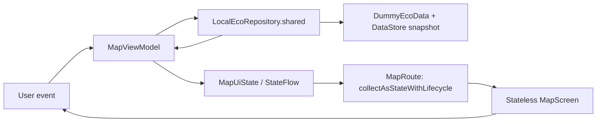

# EcoDala Android — SIS4 MVVM

EcoDala helps demonstrate recycling habits with the existing Compose design, local EcoPoints, a live recycling map and an animated virtual tree. This version refactors the existing application for SIS4; it does not need an EcoDala backend.

## Features

- Animated splash, validated local login and registration.
- Home dashboard; recycling map with OSMDroid, 12 demo locations and coloured markers.
- Search by name/address/waste type, category LazyRow, list mode using LazyColumn, favourites and point details.
- Waste type, quantity, kg/g/pcs/bag selection, comment, reward calculation and success confirmation.
- Shared EcoPoints, recycling history, Virtual Tree levels 0–10, challenges, achievements and student/faculty leaderboard.
- Profile editing, local support demonstration, settings, dark mode and English/Russian/Kazakh labels.

Email verification, password reset, AI scanning, camera, push notifications, secondary map layers and production networking were intentionally removed. Existing illustrations, tree animations, ranking components, themes and adaptive helpers remain.

## Architecture



ViewModels contain application state and access repositories. Routes collect read-only StateFlow using lifecycle-aware collection and connect event lambdas. Screens render values and keep only presentation state such as expansion/scroll. `MapScreen` has no repository or ViewModel dependency. Search/category filtering is the derived `MapUiState.filteredPoints` property, outside the Composable.

See [actual screen mapping and events](design/SIS4_MVVM.md), [initial inventory and plan](docs/SIS4_REFACTOR_PLAN.md), [verification](docs/SIS4_VERIFICATION.md) and [defense guide](SIS4_DEFENSE_GUIDE.md).

## One source of truth

`LocalEcoRepository.shared` owns private recycling fixtures and a private MutableStateFlow of `LocalEcoData` (history, ledger, favourite IDs). It exposes `asStateFlow()`. All retained feature ViewModels share this repository; `DemoPointsEconomyRepository` adapts it to the existing economy use cases.

Submission validates quantity/unit, reuses `EcoRatingCalculator.pointsForWaste`, saves history/favourites through the existing DataStore approach, and publishes history and ledger together. Home, Profile, History, Tree, Challenges, Achievements and Leaderboard observe changes. Faculty totals include the current user's added points. The initial ledger totals 845; the tree uses the existing 100-points-per-level calculation, so the initial actual level is 8.

Repository loading uses `delay(600)`. Public operations return `Result`; map failures are explicit and never replaced with hidden fallback data. A bug icon enables the demo error. Retry retries the current mode; disable the mode to load content again.

DataStore retains session identity, settings, added submissions and favourites after app restart. Demo fixtures and faculty peers are illustrative. Support only acknowledges a local request and does not send it. Startup storage failures show an error and Retry. Search and category are saved with SavedStateHandle; local points/favourites live in the shared source.

## Navigation

Splash → Login/Register → Home. The existing bottom bar opens Home, Map, Submit, Leaderboard and Profile. Home also opens Tree, Challenges and Achievements. Profile opens History, Achievements, Settings and Support.

`recycling-point/{pointId}` declares a String navigation argument. Navigation supplies SavedStateHandle to `RecyclingPointDetailsViewModel`; its existing `pointId` mechanism is preserved. An invalid ID shows an error instead of an unrelated first point. Route actions use an external geo Intent; an installed maps handler is needed.

## Four states and rotation

Map has Loading, Content, Empty and Error. Open List for the 12-item LazyColumn. A nonsense search gives Empty. Use the bug button for Error and Retry. Five previews in MapScreen cover the four states and dark mode without a ViewModel or backend.

Search, category and list mode are saved in SavedStateHandle. Favourite IDs are in the shared repository and DataStore. A retained MapViewModel survives Activity recreation; MainActivity logs all six requested callbacks and MapViewModel logs init/onCleared with instance IDs. Recomposition alone is not evidence of rotation. Actual runtime evidence and any unverified checks are listed in the verification report.

## Technologies and build

Kotlin 2.0.20, Compose/Material 3, Navigation Compose, lifecycle ViewModel/StateFlow/coroutines, Preferences DataStore, OSMDroid. No Hilt, Room, Retrofit, Moshi, JWT, CameraX or Google Maps SDK. Core library desugaring supplies java.time for minSdk 24, following the [Android API desugaring documentation](https://developer.android.com/studio/write/java8-support#library-desugaring).

Use JDK **21** and an Android SDK with platform 35. Gradle uses a 1536 MB heap, two workers and in-process Kotlin compilation to reduce memory pressure alongside Android Studio. Gradle wrapper 8.13 and AGP 8.13.2 are preserved. Java/Kotlin bytecode and the Gradle daemon target 21. In Android Studio choose an installed JDK 21 under Settings → Build Tools → Gradle → Gradle JDK, then Sync.

```powershell
$env:JAVA_HOME = 'C:\Users\zhako\.jdks\jbr-21.0.11'
.\gradlew.bat :app:assembleDebug
.\gradlew.bat :app:testDebugUnitTest
```

For another computer set JAVA_HOME to its JDK 21. Set `sdk.dir` in ignored `local.properties` or configure the SDK in Android Studio. No API key or backend URL is needed. Debug APK: `app/build/outputs/apk/debug/app-debug.apk`. Existing optional release signing is retained; configure keystore.properties only when signing a release.

Use a valid email and a nonempty login password; for example `demo@ecodala.kz` / `DemoPass123!`. This is a shared local demo identity, not separate secure accounts. Registration validates name, email, strong password, matching confirmation and terms, then opens Home immediately. Google/Apple buttons are explicitly labelled Demo and retain the explanatory dialog. Passwords are not stored or authenticated by a server.

## Demo limits and recovery

All 12 locations, ratings, opening times and distances are educational fixtures, not verified businesses. Map tiles require internet (cached tiles may work offline), while all EcoDala data works locally. Background tile availability is separate from the demonstrated repository error state. Device GPS and permissions were removed. No real support, provider authentication, remote accounts, moderation, or cross-device sync exists. Challenge/achievement reward figures describe demo milestones; only recorded ledger events contribute to the balance. Tree preview buttons intentionally show example levels until actual data changes or the screen reopens.

The project initially had no Git repository. The original complete directory is archived privately at `.sis4-backup/original-project.zip` (including local configuration and caches), and the initial source checkpoint is branch `original-checkpoint`, commit `92d2f5d`. Work is on `refactor/sis4`. No remote push or history rewrite was performed. Do not publish the private backup. Historical backend handoff documents are retained as historical references with explicit notices.
