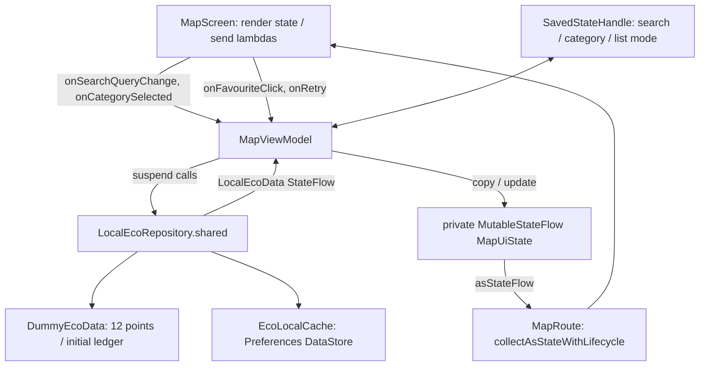

# SIS4 — actual MVVM design

## Data flow

## Screen / ViewModel / data mapping

All paths below are under `app/src/main/java/com/ecodala/`.

| Screen/Route | Existing ViewModel | Data / logic |
|---|---|---|
| SplashScreen | SplashViewModel retained; animation itself calls onFinished | SessionManager in nav graph |
| LoginScreen, RegisterScreen | AuthViewModel | LoginUseCase/RegisterUseCase/SocialLoginUseCase → DemoAuthRepository → SessionManager |
| HomeScreen | HomeViewModel | LocalEcoRepository; DemoPointsEconomyRepository adapter; wallet, impact, streak, achievement use cases |
| MapScreen | MapViewModel | LocalEcoRepository; MapUiState derived filtering; SavedStateHandle |
| RecyclingPointDetailsScreen | RecyclingPointDetailsViewModel | SavedStateHandle pointId → LocalEcoRepository.recyclingPoint |
| SubmitWasteScreen | SubmitWasteViewModel | LocalEcoRepository.submitWaste; EcoRatingCalculator |
| VirtualTreeScreen | VirtualTreeViewModel | Shared points → existing EcoRatingCalculator / growth history |
| ChallengesScreen | ChallengesViewModel | LocalEcoRepository.challenges, deterministic local submissions |
| AchievementsScreen | AchievementsViewModel | LocalEcoRepository.achievements → GetAchievementProgressUseCase |
| LeaderboardScreen | LeaderboardViewModel | Repository ranks users; existing faculty fixtures + shared progress; FacultyLeaderboardSummary |
| ProfileScreen | ProfileViewModel | Repository/economy adapter; SessionManager profile/logout |
| RecyclingHistoryScreen | RecyclingHistoryViewModel | Shared submissions; selected type in UiState |
| SettingsScreen | SettingsViewModel | AppSettingsStore/DataStore |
| SupportScreen | SupportViewModel | Local SupportUiState; no service |

## MapUiState

| Field | Meaning / owner |
|---|---|
| searchQuery | User text; ViewModel and SavedStateHandle |
| selectedWasteType | Null means All; SavedStateHandle stores enum name |
| allPoints | Repository result; empty during error |
| filteredPoints | Derived search/category matches; checks **every** accepted waste type |
| favouriteIds | Read from shared LocalEcoData/DataStore |
| selectedPoint | Marker selection; presentation selection held in VM |
| isLoading | Repository request running |
| errorMessage | Explicit failure; no silent fallback |
| demoErrorEnabled | Current demo mode, survives rotation via retained VM |
| showList | Map/List presentation choice saved in SavedStateHandle |

No Composable mutates a repository or filters points. `MapScreen` receives state and lambdas. Card expansion and map viewport are presentation state. Map lifecycle calls onResume/onPause/onDetach; all custom GPS and route service calculations are gone.

## Events

- onSearchQueryChange(text): saves text, clears marker selection, publishes copy.
- onCategorySelected(type): saves category, clears selection; filteredPoints is derived.
- onFavouriteClick(id): repository validates ID, saves favourite set, publishes data; VM observes.
- onRetry(): cancels old load job and requests the current error mode again.
- onDemoErrorClick()/onDemoErrorDisabled(): enables/disables simulated failure then reloads.
- onListModeChange(): saves list choice and clears marker selection.
- onPointSelected()/onSelectionDismiss(): updates the selected marker card.

## Trace One Click — favourite

1. Tap the heart on a point in Map List.
2. `MapScreen` invokes `onFavouriteClick(point.id)`.
3. `MapRoute` connects this lambda to `MapViewModel.onFavouriteClick`.
4. `viewModelScope.launch` calls `LocalEcoRepository.setFavourite`.
5. The repository toggles the ID, saves DataStore, publishes a new LocalEcoData.
6. MapViewModel's collector publishes `state.copy(favouriteIds = data.favouriteIds)`.
7. `uiState.asStateFlow()` reaches MapRoute via `collectAsStateWithLifecycle`.
8. `IconToggleButton` is recomposed with checked=true/false. Rotation keeps VM state; storage also retains the favourite.

## Real responsibility extraction

Previously `FacultyLeaderboardContent` sorted faculties and calculated leader, total points and total members inside a Composable. `FacultyLeaderboardSummary.from` now prepares the aggregate in the ViewModel file; LeaderboardViewModel sorts/ranks and publishes faculties plus summary. Route collects it, and the existing hero/list components only render values. Existing map route-service logic was removed, rather than disguised as a new utility layer.
