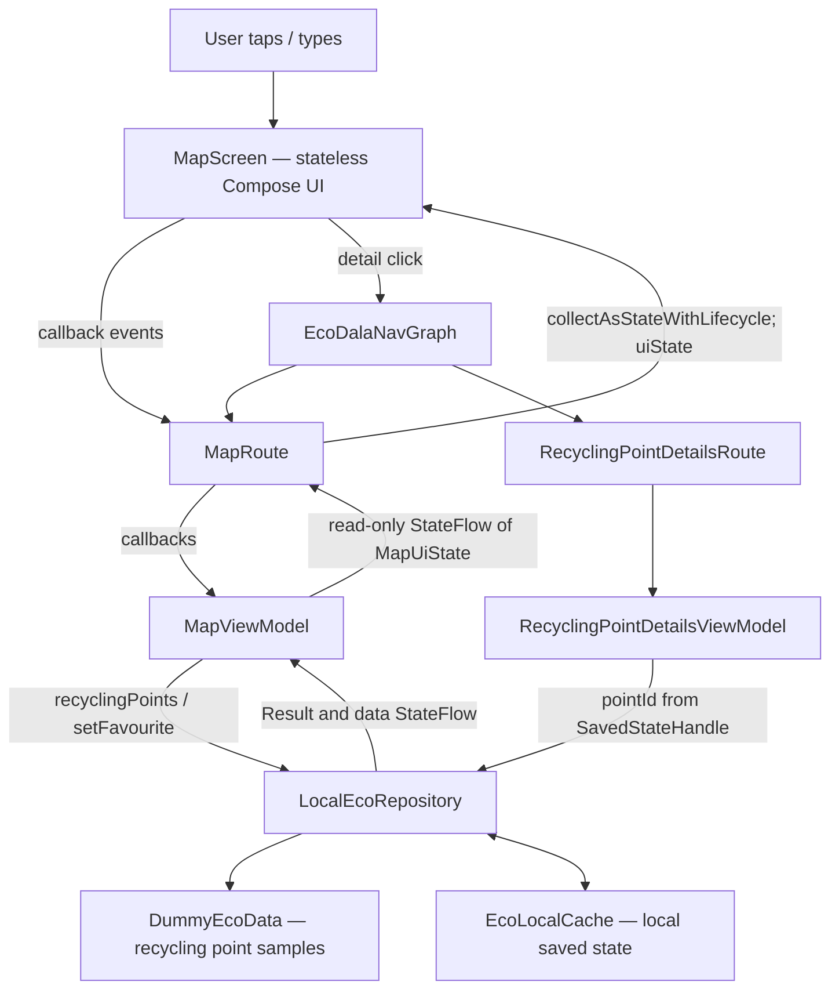

# EcoDala — SIS4 MVVM Architecture (current implementation)

**Assignment:** SIS4 — Refactor Your App to MVVM
**Package:** `com.ecodala`
**Status:** Documentation of the current workspace, checked on 2026-10-19. This is **not** a pre-refactoring plan and should not be presented as an earlier Git commit.

## 1. Why MVVM?

EcoDala separates the interface (**View**), the state and screen actions (**ViewModel**), and the data source (**Repository**). User events travel from the screen toward the ViewModel. Updated immutable UI state travels back to the screen through `StateFlow`. The main SIS4 demonstration uses the recycling map/list feature.

## 2. Architecture diagram



The diagram focuses on the principal SIS4 demonstration path, not every EcoDala feature.

## 3. Actual files and responsibilities

| Layer | Existing file | Responsibility |
| --- | --- | --- |
| Navigation | `app/src/main/java/com/ecodala/core/navigation/EcoDalaNavGraph.kt` | Opens `MapRoute` and navigates to recycling-point details with a `pointId` argument. |
| Route | `app/src/main/java/com/ecodala/feature/map/presentation/MapScreen.kt` → `MapRoute()` | Gets `MapViewModel`, collects `uiState` via `collectAsStateWithLifecycle()`, passes state and callbacks to `MapScreen`. |
| View | Same file → `MapScreen()` | Receives `MapUiState` and callback lambdas; displays recycling map/list and loading, content, empty, or error. |
| ViewModel/state | `app/src/main/java/com/ecodala/feature/map/presentation/MapViewModel.kt` | Defines immutable `MapUiState`, handles events, loads repository data and publishes a read-only `StateFlow`. |
| Repository | `app/src/main/java/com/ecodala/core/data/repository/LocalEcoRepository.kt` | Owns recycling point data, simulates latency and errors, handles favourites and local eco data. |
| Demo data | `app/src/main/java/com/ecodala/core/data/dummy/DummyEcoData.kt` | Supplies sample recycling points. |
| Saved local state | `app/src/main/java/com/ecodala/core/data/local/EcoLocalCache.kt` | Persists relevant repository data. |
| Details ViewModel | `app/src/main/java/com/ecodala/feature/map/presentation/RecyclingPointDetailsViewModel.kt` | Reads `pointId` from `SavedStateHandle` and loads a specific point. |
| Lifecycle proof | `app/src/main/java/com/ecodala/MainActivity.kt` | Logs Activity lifecycle callbacks. |

Other preserved screens include Home, Leaderboard, Challenges, Achievements, Virtual Tree, Profile, and Waste Submission. They are part of the product but are not the primary demonstration path described above.

## 4. MapUiState — fields ('order board')

All constructor properties of `MapUiState` are declared with `val`.

| Field | Type | Purpose |
| --- | --- | --- |
| `searchQuery` | `String` | Current recycling-point search text. |
| `selectedWasteType` | `WasteType?` | Active waste-category filter; `null` means all. |
| `allPoints` | `List<RecyclingPoint>` | Complete result of the latest load. |
| `favouriteIds` | `Set<String>` | IDs of favourited recycling points, updated from repository data. |
| `selectedPoint` | `RecyclingPoint?` | Currently selected map point. |
| `isLoading` | `Boolean` | Whether point data are loading. |
| `errorMessage` | `String?` | Loading/error message, if any. |
| `demoErrorEnabled` | `Boolean` | Whether the next load should simulate a failure. |
| `showList` | `Boolean` | Whether the UI displays list mode instead of map mode. |
| `filteredPoints` | computed `List<RecyclingPoint>` | Derived result of applying text and waste-type filters (calculated in `MapUiState`, **not** in `MapScreen`). |

The ViewModel exposes the state like this:

```kotlin
private val _uiState = MutableStateFlow(MapUiState(/* restored values */))
val uiState: StateFlow<MapUiState> = _uiState.asStateFlow()
```

Updates use `_uiState.update { it.copy(...) }` instead of mutating UI state in place.

## 5. User events ('orders')

| UI action | Existing ViewModel handler | State/data effect |
| --- | --- | --- |
| Type a search | `onSearchQueryChange(value)` | Updates `searchQuery` and stores it in `SavedStateHandle`; `filteredPoints` recalculates from state. |
| Select a category | `onCategorySelected(type)` | Updates `selectedWasteType` and stores it in `SavedStateHandle`. |
| Tap favourite | `onFavouriteClick(id)` | Calls `repository.setFavourite(id)`; repository `data` flow updates `favouriteIds` in `MapUiState`. |
| Retry failed load | `onRetry()` | Calls `refreshMapData()`, then loading completes or an error is shown. |
| Toggle demo error | `onDemoErrorClick()` / `onDemoErrorDisabled()` | Turns simulated failure on/off and reloads. |
| Switch map/list | `onListModeChange()` | Updates `showList`, saved in `SavedStateHandle`. |
| Select/dismiss marker | `onPointSelected(point)` / `onSelectionDismiss()` | Changes `selectedPoint`. |

## 6. Trace one click — favourite recycling point

1. The user taps the favourite icon in `MapScreen()`.
2. The screen invokes its `onFavouriteClick(point.id)` callback.
3. `MapRoute()` supplies `viewModel::onFavouriteClick` as this callback.
4. `MapViewModel.onFavouriteClick(id)` launches a coroutine and calls `LocalEcoRepository.setFavourite(id)`.
5. The repository updates its stored favourite IDs and emits the new `data` value.
6. `MapViewModel` collects repository `data` and updates `MapUiState` using `copy(favouriteIds = ...)`.
7. `MapRoute` collects the public `uiState` with `collectAsStateWithLifecycle()`.
8. `MapScreen` recomposes and displays the new favourite icon state.

**Unidirectional flow:** **Event ↑** Screen → Route → ViewModel → Repository; **State ↓** Repository → ViewModel → StateFlow → Route → Screen.

## 7. Four required UI states

| UI state | Trigger / meaning | Existing Preview |
| --- | --- | --- |
| Loading | `isLoading = true` before repository result | `MapLoadingPreview` |
| Content | Loaded, nonempty `filteredPoints` | `MapContentPreview` |
| Empty | No matches for search/category or no available points | `MapEmptyPreview` |
| Error | Repository returns `Result.failure` and sets `errorMessage` | `MapErrorPreview` |

`MapDarkPreview` additionally demonstrates the dark theme. Preview declarations exist in `MapScreen.kt`; whether they render correctly in Android Studio must be checked there.

## 8. Repository: latency and error simulation

`LocalEcoRepository.recyclingPoints(simulateError)` performs `delay(loadingDelayMillis)` (default 600 ms) and returns either `Result.success(points.toList())` or `Result.failure(IllegalStateException("Demo loading error"))`. This simulates a remote service without requiring a real backend. On the Map screen, the demo error control enables/disables failure; Retry calls `refreshMapData()` again.

## 9. Rotation and ViewModel lifecycle

`MapViewModel` holds the important state. Search, category and list-mode values are also written to `SavedStateHandle`; favourites are backed by repository data. Rotate the emulator after entering a search, selecting a filter and toggling a favourite, then verify all values remain as expected.

`MainActivity.kt` logs `onCreate`, `onStart`, `onResume`, `onPause`, `onStop` and `onDestroy` under tag `SIS4.MainActivity`. `MapViewModel.kt` logs `init` and `onCleared` under `SIS4.MapViewModel`. Capture **actual** Logcat output after rotation and place it in the root `README.md`, with a short explanation. Do not substitute an illustrative log for observed evidence.

## 10. SIS4 requirements and outstanding evidence

- Architecture diagram, fields, events and one-click trace: documented above.
- Repository owns data, delays requests and simulates errors: implemented in source.
- ViewModel exposes a read-only `StateFlow`, immutable state and 3+ actions: implemented in source.
- Route/Screen split and four previews: implemented in source; Preview rendering requires Android Studio verification.
- Rotation state survival: expected from current architecture; **must be verified on emulator/device**.
- Activity and ViewModel logging: implemented in source; **actual Logcat must be captured and included in README**.
- Git requirement: SIS4 asks for `/design` to be committed **before** implementation. This current-implementation document must not be represented as an earlier plan or backdated commit.

*Source: current workspace code and the supplied SIS4 assignment.*
